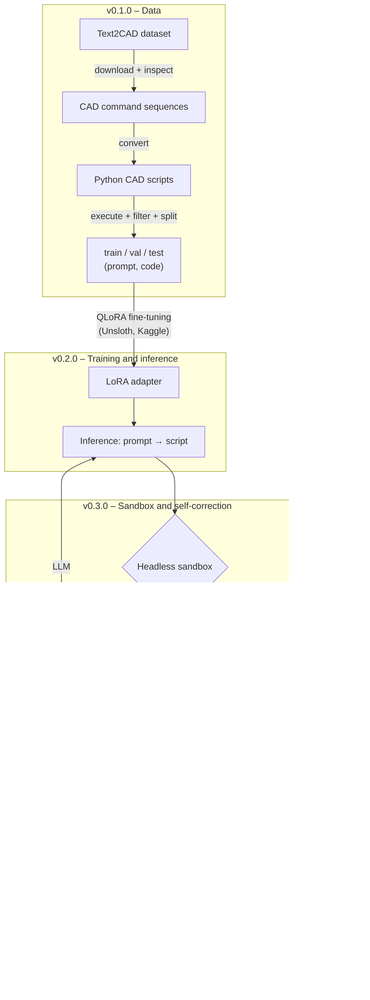

# Developer Guide

Everything you need to set up, run and contribute to `text2cad`.

> **Audience**: this document is for people **modifying** `text2cad`.
> If you only want to **use** it, start with [`README.md`](./README.md).

> **Project status**: the project is at the start of milestone v0.1.0. No source code is merged yet.
> The layout and commands below describe the target structure. Update this file in the same PR that adds or changes a directory or command.

---

## Table of contents

1. [Repository layout](#repository-layout)
2. [Prerequisites](#prerequisites)
3. [Set up](#set-up)
4. [Pipeline overview](#pipeline-overview)
5. [Working on Kaggle](#working-on-kaggle)
6. [Test](#test)
7. [Workflow](#workflow)
8. [Conventions](#conventions)
9. [Where to make changes](#where-to-make-changes)
10. [Security](#security)
11. [Troubleshooting](#troubleshooting)

---

## Repository layout

Target layout (each directory is created by the milestone that needs it):

```
src
└── text2cad                  # Python package
│   ├── data/                 # v0.1.0 – dataset download, conversion, cleaning, split
│   ├── training/             # v0.2.0 – QLoRA / Unsloth training, export
│   ├── inference/            # v0.2.0 – prompt-to-code generation
│   ├── sandbox/              # v0.3.0 – headless execution and geometry validation
│   ├── orchestration/        # v0.3.0 – self-correction loop, STEP / STL export
│   ├── evaluation/           # v0.4.0 – metrics, rendering, VLM judge
│   └── app/                  # v1.0.0 – web interface
├── notebooks/                # Kaggle notebooks (training, exploration)
├── configs/                  # Training and evaluation configuration files
├── tests/                    # Unit and integration tests
├── docs/                     # MkDocs documentation (Diátaxis)
├── .github/                  # Issue and PR templates
├── requirements.txt          # Pinned dependencies
├── mkdocs.yml
├── README.md
├── CONTRIBUTING.md
├── GIT.md
└── DEV.md                    # ← you are here
```

## Prerequisites

| Tool | Version | Why |
|---|---|---|
| **Python** | 3.11+ | Whole project |
| **git** | any recent | Version control |
| **CadQuery** or **build123d** | latest | CAD script execution (library choice: see the v0.1.0 spike) |
| **CUDA GPU** | 16 GB VRAM | Only for local training or inference; Kaggle T4 / P100 is the reference |
| **Kaggle account** | n/a | Training runs |
| **Hugging Face account** | n/a | Dataset and model storage |

CadQuery and build123d depend on OpenCASCADE (OCP). The PyPI wheels include it on Linux, macOS and Windows.

## Set up

```bash
git clone https://github.com/YOUR_USERNAME/text2cad
cd text2cad
python -m venv .venv
source .venv/bin/activate
pip install -r requirements.txt
```

Until `requirements.txt` exists, install the tools for the area you work on (for example `pip install cadquery` or `pip install build123d`).

Credentials are read from environment variables. Never commit tokens.

```bash
export HF_TOKEN=...          # Hugging Face
export WANDB_API_KEY=...     # only if you use Weights & Biases
```

## Pipeline overview



Each block maps to a milestone and a parent issue on GitHub. See the [open issues](https://github.com/remiboivin021/text2cad/issues) and [milestones](https://github.com/remiboivin021/text2cad/milestones).

## Working on Kaggle

Training and heavy experiments run on Kaggle GPUs (T4 x2 or P100, 16 GB VRAM per GPU).

- Keep notebooks in `notebooks/` and commit them without large outputs.
- Install the project inside the notebook from the repository, not from copied code.
- Save checkpoints often: Kaggle sessions have a time limit.
- Record the config file, the dataset version and the commit hash with every run.
- Store large artifacts (datasets, checkpoints, adapters) on Hugging Face, never in git.

## Test

```bash
pytest                      # all tests
pytest tests/data           # one area
pytest -m "not slow"        # skip slow tests (geometry execution on many samples)
```

Rules:

- Every converter rule, metric and sandbox status has a unit test.
- Tests that execute CAD code use small, fixed samples.
- Tests must not require a GPU. Mark GPU tests with `@pytest.mark.gpu` and skip them by default.

## Workflow

The full policy is in [GIT.md](./GIT.md). Summary:

- Fork the repository and branch from `develop`: `feat/<name>`, `bug/<name>`, `hotfix/<name>`.
- Commit with the structured format described in [GIT.md](./GIT.md) and [CONTRIBUTING.md](./CONTRIBUTING.md#commit-message-guidelines).
- Open a PR against `develop` and fill the PR template.
- Link the PR to its issue with `Closes #<number>`.

### Issues

Work is tracked with GitHub issues, grouped by milestone. Each roadmap item is a **parent issue** with **sub-issues**.

| Type | Use for | Template |
|---|---|---|
| Feature | New capability | `feature_request.yml` |
| Task | Setup, configuration, data operations, release work | `task.yml` |
| Spike | Short, time-boxed technical question | `spike.yml` |
| R&D | Long-term research | `research_and_development.yml` |
| Docs | Documentation | `documentation.yml` |
| Bug | Defect | `bug_report.yml` |

## Conventions

### Python

- Formatting and lint: `ruff format` and `ruff check`.
- Type hints on public functions; check with `mypy`.
- Docstrings on public modules, classes and functions.
- Paths with `pathlib`, configuration in files under `configs/`, no hard-coded paths or secrets.
- Random seeds are explicit and configurable.

### Generated CAD code

- One code style for all converted scripts (imports, naming, units in millimetres).
- A converted script defines one final solid in a known variable name, so the sandbox can find it.

### Docs

- MkDocs with the Diátaxis structure: tutorials, how-to guides, reference, explanation.
- A PR that changes behavior updates the matching documentation.

## Where to make changes

| You want to… | Touch |
|---|---|
| Support a new CAD command in the converter | `text2cad/data/`, add a unit test per command |
| Change the dataset split or filters | `text2cad/data/`, bump the dataset version |
| Change training hyperparameters | `configs/`, not the training code |
| Change the prompt template | One shared definition used by training and inference |
| Add a sandbox check or error status | `text2cad/sandbox/`, update the repair prompt if needed |
| Add an evaluation metric | `text2cad/evaluation/`, document the normalisation |
| Change the web interface | `text2cad/app/` |
| Add a doc page | `docs/`, in the Diátaxis section that fits |

## Security

Generated scripts are **untrusted code**. Run them only through the sandbox, never with `exec()` in the main process. Changes to `text2cad/sandbox/` need a security review in the PR.

Report vulnerabilities privately to the maintainer (see [README.md](./README.md#contact)), not in a public issue.

## Troubleshooting

| Symptom | First thing to try |
|---|---|
| `ImportError` on `OCP` or `cadquery` | Reinstall in a clean venv with Python 3.11+ |
| CUDA out of memory on Kaggle | Lower the max sequence length or the batch size, enable gradient checkpointing |
| Kaggle session ends during training | Resume from the last checkpoint |
| Offscreen rendering fails | Install an offscreen OpenGL backend (OSMesa or EGL) |
| Generated script hangs | Check the sandbox timeout setting |
