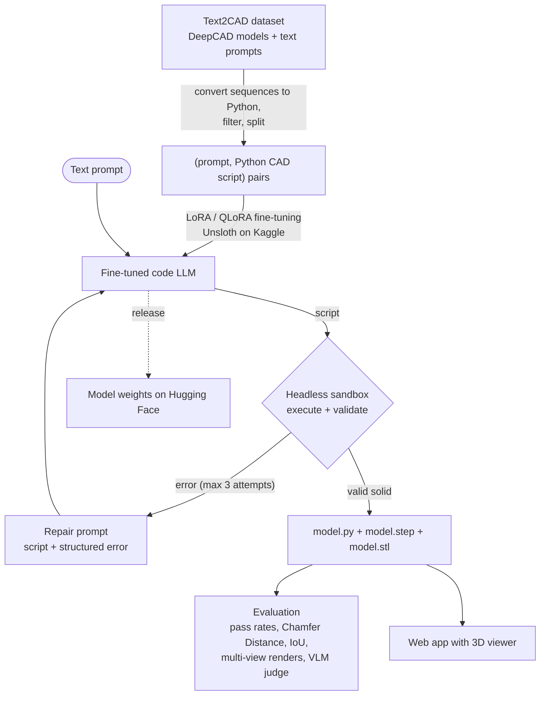

# text2cad

**Generate parametric 3D CAD models from natural language.**

text2cad fine-tunes a lightweight code Large Language Model (3B–7B parameters) to turn a text description into an executable Python CAD script. The script builds a solid with an open-source CAD library (CadQuery or build123d) and exports it as `.step` and `.stl`.

```text
"A rectangular plate, 80 × 40 × 5 mm, with four 4 mm holes 6 mm from each corner"
                                  │
                                  ▼
                    Python CAD script  ──▶  model.step  +  model.stl
```

!!! warning "Project status"
    The project is at the start of milestone **v0.1.0 – Data Pipeline & Preprocessing**.
    No source code is merged yet. These pages describe the goals and the planned design. They will be updated as each milestone lands.

---

## Why text2cad

- **Editable output.** The model writes parametric Python code, not a mesh. You can read the code, change a dimension and run it again, or open the STEP file in any CAD software.
- **Lightweight.** The target is a 3B–7B code model (Qwen2.5-Coder) fine-tuned with LoRA / QLoRA on free Kaggle GPUs. It is small enough to run on one consumer GPU.
- **Validated geometry.** Every generated script runs in an isolated, headless sandbox. Syntax errors, OpenCASCADE errors and invalid solids are detected and sent back to the model, which tries to fix its own code.
- **Measured quality.** Results are evaluated with the metrics used in text-to-CAD research (execution pass rate, invalidity ratio, Chamfer Distance, IoU), plus a vision-language model that checks the rendered part against the prompt.

## How it works



1. **Data.** The [Text2CAD](https://huggingface.co/datasets/SadilKhan/Text2CAD) dataset adds text descriptions, from abstract to expert level, to the CAD construction sequences of [DeepCAD](https://github.com/rundiwu/DeepCAD). Each sequence is converted into a clean Python script and checked by execution.
2. **Training.** An AI model is fine-tuned on the (prompt, script) pairs on Kaggle GPUs.
3. **Generation and self-correction.** The model writes a script. The sandbox runs it, validates the solid (single solid, positive volume, valid BREP, watertight mesh) and returns structured errors. On failure, the error goes back to the model in a repair prompt.
4. **Export.** Valid solids are saved as `.step` (exact CAD geometry) and `.stl` (mesh), with a metadata file for each run.
5. **Evaluation.** The pipeline is measured on the official DeepCAD test split, so results can be compared with published work.

## Roadmap

| Milestone | Goal |
|---|---|
| **v0.1.0** – Data Pipeline & Preprocessing | Download and inspect Text2CAD, convert CAD sequences to Python scripts, filter and split the dataset |
| **v0.2.0** – Baseline Model Fine-Tuning (MVP) | Set up Unsloth training on Kaggle, fine-tune Qwen2.5-Coder 3B / 7B, export adapters, first inference |
| **v0.3.0** – Orchestration & Self-Correction Loop | Headless sandbox, error-feedback repair loop, STEP / STL export |
| **v0.4.0** – Evaluation & Visual Verification | Pass rates, Chamfer Distance and IoU, multi-view rendering, VLM judge |
| **v1.0.0** – Interactive UI & Public Release | Web app with 3D viewer, model weights on Hugging Face, complete documentation |

Progress is tracked in the [milestones](https://github.com/remiboivin021/text2cad/milestones) and [issues](https://github.com/remiboivin021/text2cad/issues) on GitHub.

## Get involved

- **Contribute:** read the [Contributing guide](https://github.com/remiboivin021/text2cad/blob/main/CONTRIBUTING.md), the [Git workflow](https://github.com/remiboivin021/text2cad/blob/main/GIT.md) and the [Developer guide](https://github.com/remiboivin021/text2cad/blob/main/DEV.md).
- **Report a problem or propose an idea:** open an issue with the matching [issue form](https://github.com/remiboivin021/text2cad/issues/new/choose).
- **Security:** generated scripts are untrusted code. Report vulnerabilities privately to the maintainer, not in a public issue.

## Licenses

- **Code:** [GPL-3.0](https://github.com/remiboivin021/text2cad/blob/main/LICENSE).
- **Data:** the Text2CAD dataset is published under CC BY-NC-SA 4.0 (non-commercial, share-alike). Datasets derived from it keep this license.
- **Model weights:** the license will be set at release (v1.0.0). It must respect the dataset license and the license of the base model.

## Related work

- [Text2CAD](https://arxiv.org/abs/2409.17106): text-to-CAD dataset and transformer model (NeurIPS 2024).
- [Text-to-CadQuery](https://arxiv.org/abs/2505.06507): LLM fine-tuning on Text2CAD prompts paired with CadQuery code.
- [CAD-Coder](https://arxiv.org/abs/2505.19713): text-to-CadQuery generation with chain-of-thought and a geometric reward.
- [CADmium](https://arxiv.org/abs/2507.09792): Qwen2.5-Coder fine-tuned for text-driven CAD sequences.
- [CAD-Recode](https://arxiv.org/abs/2412.14042): CadQuery code generation from point clouds.
